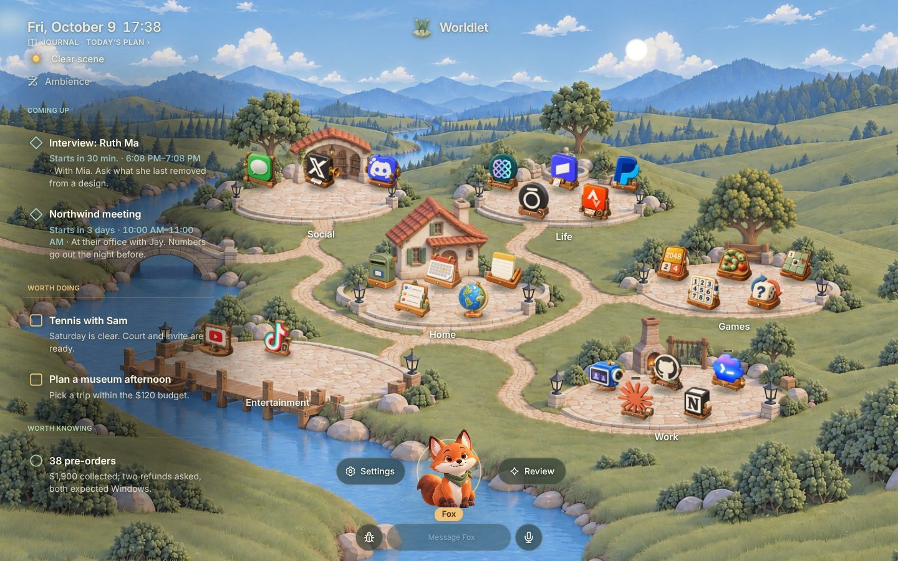
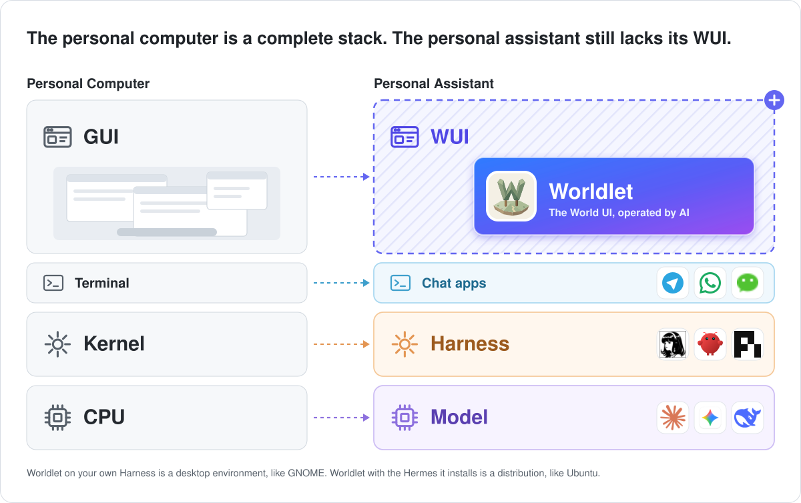
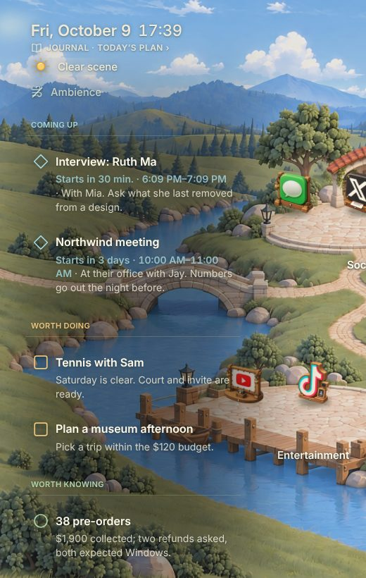
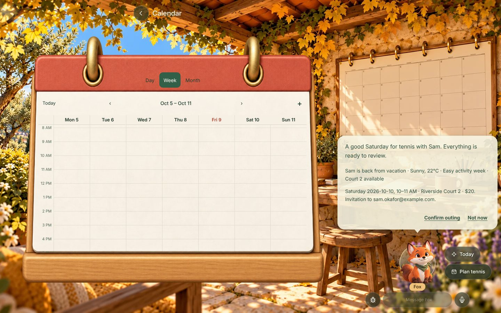
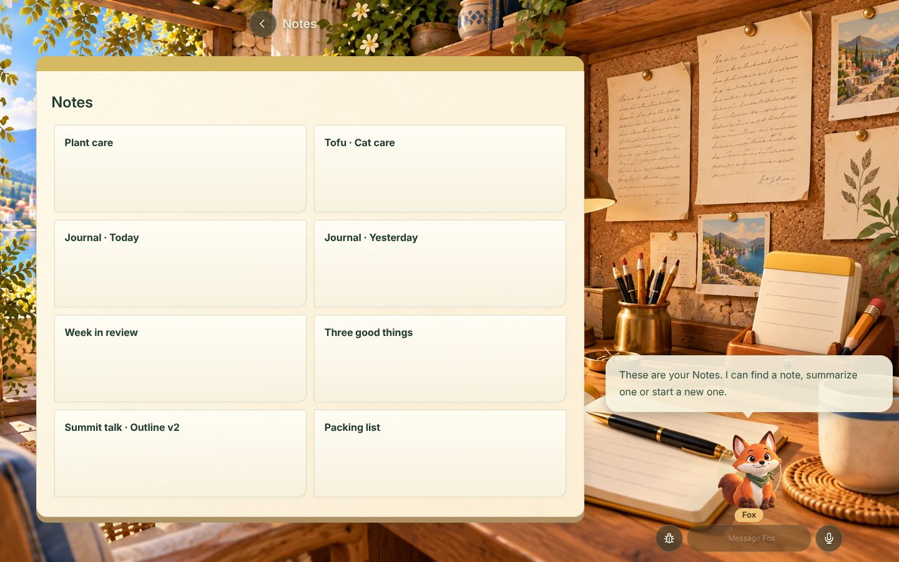

<h1 align="center">
  <a href="https://worldlet.ai"></a> Worldlet
</h1>

<p align="center">
  <a href="https://github.com/clockless-org/worldlet"></a>
  <a href="https://github.com/clockless-org/worldlet/releases"></a>
  <a href="LICENSE"></a>
  
</p>

<p align="center">
  <sub><a href="README.zh.md">中文</a></sub>
</p>

<p align="center">
  <strong>The first World UI (WUI) framework.</strong><br/>
  A World for the AI Agent you already use: not a chat box, a place your Agent works in.<br/>
  Worldlet gives OpenClaw, Hermes Agent, Claude Code, Codex or pi a place to work that you can see. The World is operated by AI; you watch and decide.
</p>

<p align="center">
  
</p>

<h3 align="center"><a href="#install"><ins>Install in one command</ins></a> · <a href="https://worldlet.ai/download/"><ins>Download</ins></a></h3>

## Your Agent, your model: the stack in computer terms

<p align="center">
  <a href="contracts/HARNESS.md"></a>
</p>

Worldlet provides no model of its own. It talks through your Agent and borrows its sign-ins, connections, skills and memory, and gives the Agent World tools over the `worldlet` MCP server. Switch Agents and your World stays.

| Computer | AI era | Who owns it |
| --- | --- | --- |
| CPU | Model | Your model provider (your own sign-in or API key) |
| Kernel | Harness: Hermes Agent, OpenClaw, Claude Code, Codex, pi | Your choice, replaceable |
| Drivers and keychain | MCP servers, connectors and their tokens | Your Harness; Worldlet borrows them, and keeps the services you connect in Settings › Connectors on your computer |
| Terminal | Chat apps and command lines | Where Agents live today |
| Graphical system | Worldlet: World, Things, Fox, Attention Center | This project |
| System API | World tools, served to the Agent over the `worldlet` MCP server | This project |
| Disk | `world.sqlite` and World storage, on your computer | This project |

Worldlet on your own Harness is a desktop environment, like GNOME; with the Hermes Agent it installs, it is a distribution, like Ubuntu. World → Agent tools go over MCP; Agent → World goes through one adapter per Harness ([Harness contract](contracts/HARNESS.md), [interactive architecture diagram](docs/architecture.html)).

## Install

**macOS**

```sh
curl -fsSL https://worldlet.ai/install.sh | sh
```

**Windows** (PowerShell)

```powershell
irm https://worldlet.ai/install.ps1 | iex
```

The installer downloads the newest release, checks its SHA-256 (and the app's signature on Mac), installs it and opens it. To connect a particular Agent without being asked, name it: `openclaw`, `hermes`, `pi`, `claude-code` or `codex`.

```sh
curl -fsSL https://worldlet.ai/install.sh | sh -s -- --agent openclaw
```

```powershell
& ([scriptblock]::Create((irm https://worldlet.ai/install.ps1))) -Agent hermes
```

Prefer a regular installer? [Download from worldlet.ai](https://worldlet.ai/download/) or take one from [GitHub Releases](https://github.com/clockless-org/worldlet/releases). **Linux or no screen**: the same `install.sh` command installs the [headless Worldlet service](platform/install/README.md#linux) and prints your World's link and a QR code to open it from a phone or another computer.

**Let your Agent do it**: tell it 「Install Worldlet: follow https://worldlet.ai/agent.md」. [agent.md](platform/install/agent.md) has any Agent run the installer with its own name, register Worldlet in itself and reply with the link and QR code; the [`worldlet` skill](harness/skills/worldlet/SKILL.md) says the same. Details: [one-line installers](platform/install/README.md).

No account is needed. If you have no Agent yet, setup installs the standard [Hermes Agent](agent/gate/PORTABILITY.md#stock-hermes-agent-for-people-with-no-agent) the official way, to its usual location; one you already have is used as it is.

## Features

<table>
<tr>
<td width="50%" valign="middle">

### Attention Center

What needs you, in one place: meetings coming up, things worth doing and news worth knowing, found in your mail, calendar and the services your Agent already reaches. Each item says why it is there.

[Docs →](docs/ATTENTION-CENTER.md)

</td>
<td width="50%">
  <a href="docs/ATTENTION-CENTER.md"></a>
</td>
</tr>
<tr>
<td width="50%" valign="middle">

### Fox prepares, you decide

Fox is the companion you talk to, by text or voice. It does the work through your Agent and lays the result out for you: here, a tennis booking with the court, the weather and the invitation ready. Nothing is sent, paid or deleted until you confirm.

[Docs →](docs/FOX-AGENT.md)

</td>
<td width="50%">
  <a href="docs/FOX-AGENT.md"></a>
</td>
</tr>
<tr>
<td width="50%" valign="middle">

### Things

Mail, Calendar, Notes, GitHub, Notion, Linear and the other Applets that connect your accounts or read this computer, plus the Browser and games, each a small place in the World. An Applet shows your own records in a calm, readable view, and the real website when you want it.

[Docs →](docs/APPLET-RUNTIME.md)

</td>
<td width="50%">
  <a href="docs/APPLET-RUNTIME.md"></a>
</td>
</tr>
</table>

**Also in the box:**

- **[Phone companions](platform/ios/README.md)**: the Attention Center and Fox on iPhone and [Android](platform/android/README.md), paired by QR code through an end-to-end encrypted relay.
- **[Journal](ui/attention/CARD-SYSTEM.md)**: the cards Fox makes are kept, day by day.
- **[Scheduled](agent/gate/PORTABILITY.md#scheduled-jobs-on-the-persons-own-agent)**: ask once ("every morning at 8, tell me the weather and my first meeting") and Fox keeps doing it; your Agent's scheduled jobs come along. Two come with every install, on unless you turn them off: [Today’s prep at 7 AM and Wrap up today at 6 PM](context/store/ARTIFACTS.md#the-days-plan-and-summary), each one Attention card.
- **[Connectors](context/applets/INTEGRATIONS.md#settings--connectors)**: Settings › Connectors connects Google, Notion, Linear, PostHog, Cloudflare and more with their own sign-in, Search Console with your Google sign-in, and GitHub with a short code you paste on GitHub's own page (no key, no secret). A connected service's latest context is kept up to date in your World every hour (turn it off on its tile), and the Agents you allow can search it all in one place. Fox and its Agent can read a connected service, other Agents only if you choose them, and any change asks you first: an Agent's GitHub Issue or comment is written as you, with a "Drafted by" line, only after you approve it.
- **[Board](context/connectors/BOARD.md)**: a Thing for the numbers you track, such as a north-star number, a funnel or a release, read from GitHub, PostHog, Cloudflare, a JSON endpoint or your Agents' reports.
- **[Cloud Agents](agent/gate/REMOTE-MCP.md)**: Settings › Agents › **Use your World in Claude or ChatGPT** copies your World's address (Remote access, on by default) and says where to paste it; a ChatGPT, Claude or Cursor connector, or an Agent in the cloud, uses your World through `mcp.worldlet.ai`; you allow each connection on this computer, and Allow also lets it read the services you connected (or choose Allow without them).
- **[Your World's address](agent/gate/WORLD-ADDRESS.md)**: give your World its own web address, like `alex.worldlet.ai`, in Settings › Agents › Your World's address, and open it from any device. A new browser asks first, and you allow it on a card in Attention; after that a passkey signs it in. You can also share your board there, read only, with people you allow or with anyone who has the link. Nobody sees anything else, and the World stays on your computer.
- **[Your Agent on another computer](agent/gate/PORTABILITY.md#an-agent-on-another-computer)**: pair with the always-on machine where your Agent runs, and talk to it from this World.
- **[Local first](docs/WORLD-STORAGE.md)**: your records stay in `world.sqlite` on your computer.
- **[Settings](agent/gate/GRANTS.md#settings--agents)** in three parts: **Connectors** (the services your World reads), **Agents** (every Agent that uses your World, your own first, each with what it may do, what it did lately and Revoke) and **Context** (everything your World keeps, how much each holds, Save a copy and delete). Fox, Phone, General and Help sit below them.

## Your World on another device

Open your whole World, not only the Attention Center and Fox, in a web browser on a laptop or tablet. On your computer, open Settings beside Fox, choose **Phone** and, under **In a browser**, **Copy link**, then open the link on the other device. A device that can draw the World gets the full World; a phone gets the Attention Center and Fox. **Open the World** opens the same World in a browser here.

- It works while your computer is on and Worldlet runs there: the World, your records and Fox all stay on your computer, and the browser only shows them. **Run in background** keeps Worldlet running with no window open.
- The page comes from worldlet.ai, one copy per Worldlet version, and holds none of your data. What your computer and the browser say to each other is end-to-end encrypted and passes through a relay that only forwards it and stores nothing.
- Keep the link private: anyone who has it can see and act in your World. **Turn off** ends it. Settings, connections and pairing stay on your computer. [How it works](platform/web/README.md#the-world-on-another-device)

## Privacy

There is no Worldlet account, and your records stay on your computer. Official builds report basic usage analytics (setup, connection and core-operation outcomes, never message content, connected content or browsing history), and you can turn them off in Settings › General › Usage counts; see [analytics](agent/app/ANALYTICS.md). Builds you make yourself report nothing unless you configure a PostHog project.

## Build from source

Requirements: Node.js 22.19 or later.

```sh
npm ci
npm run dev            # development build with a watcher
npm run build          # build the interface and the Electron host once
npm run package        # package the desktop app for this OS (unsigned)
```

No account, secret or hosted service is needed to build. Checks: `npm run check:pr` (types, architecture and contract boundaries, docs, source layout, style) and `npm test`.

| Directory | Responsibility |
| --- | --- |
| `ui/` | Shared rendering and interaction: World, Applets, Fox, Attention Center |
| `agent/` | Who does the work: Fox, Tasks, Agents and the Gate (platform-independent rules) |
| `context/` | Everything the World knows: records, storage and Connectors (platform-independent rules) |
| `platform/` | The Electron host and the Node host (no display): OS integration, browser engine, controlled execution |
| `harness/` | Agent backends and the reference Harness adapter |
| `contracts/` | Shared Host/Agent interfaces and data shapes |
| `resources/` | Worlds, styles, artwork, fonts and media |
| `ios/`, `android/` | Phone companions |
| `scripts/`, `docs/` | Build, validation and contributor guidance |

Worldlet has one theme, the Village. A theme is static pictures, sounds and JSON ([Theme contract](resources/themes/CONTRACT.md)); Worldlet draws the animated World from it. There is no theme picker.

## Documentation

| Start here | |
| --- | --- |
| Using Worldlet, how it works, building Applets, releasing | [Documentation index](docs/README.md) (with the complete inventory) |
| Product principles | [Charter](docs/CHARTER.md) |
| Architecture | [Five layers](docs/UI-CORE-PLATFORM.md) · [Harness contract](contracts/HARNESS.md) |
| Contributing | [Contributing](CONTRIBUTING.md) · [development workflow](docs/DEVELOPMENT.md) |

## Community and support

- **Bugs and ideas:** [open an issue](https://github.com/clockless-org/worldlet/issues).
- **Security:** see [SECURITY.md](SECURITY.md); please do not file security problems as public issues.
- **Show support:** [star](https://github.com/clockless-org/worldlet) this repository to follow along.

## License

Worldlet is free and open source under the [Apache License 2.0](LICENSE). Third-party notices: [NOTICE](NOTICE).
