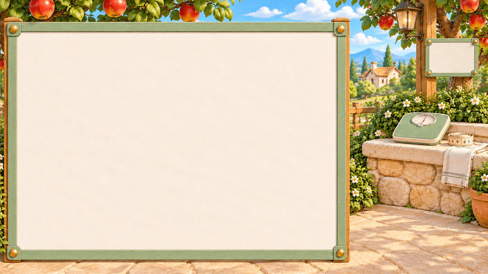
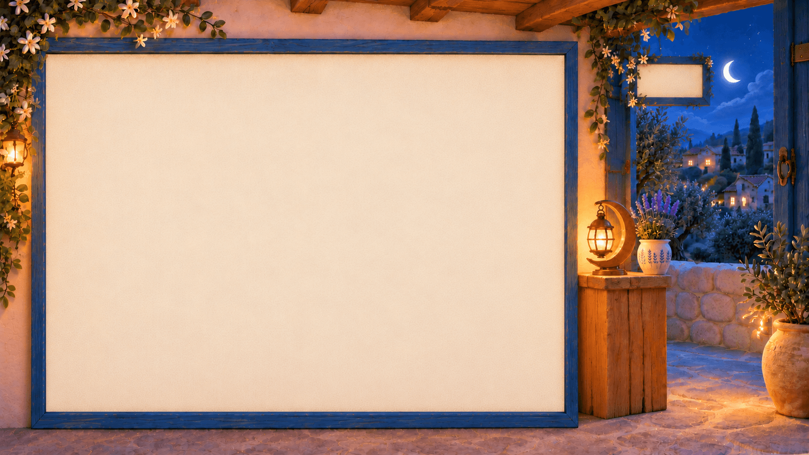
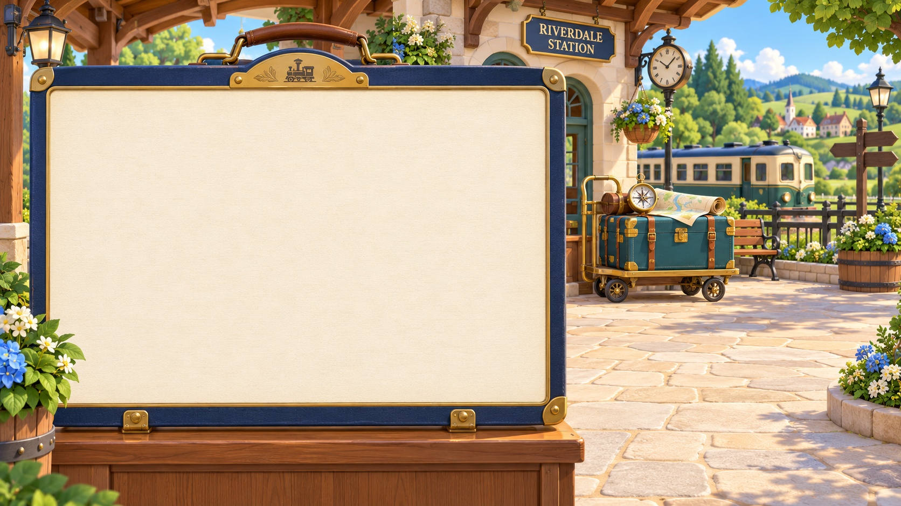
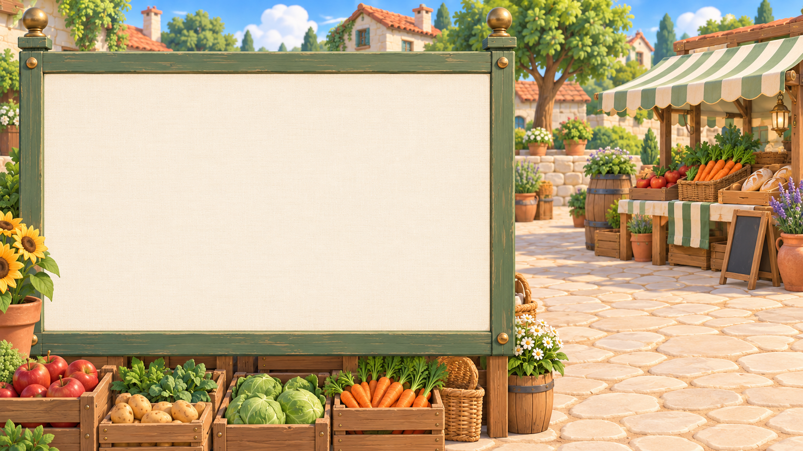
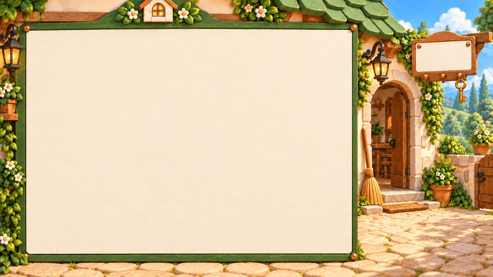
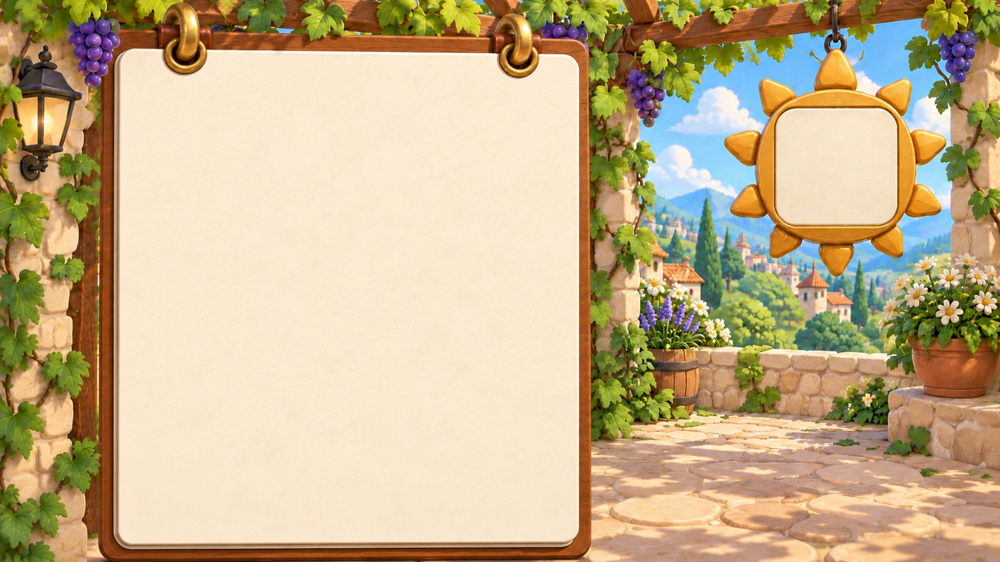

# Village personal Applet scenes

Sixteen reusable icon/background pairs for custom Applets. Their optimized WebP copies are bundled in the public repository’s Village SIM through the optional `appletPresets` section of Theme contract v3. No provider accounts, actions or data are implied by selecting a picture. The current World and existing Applets are unchanged.

[Visual catalog](index.html) · [Machine-readable catalog and exact prompts](catalog.json) · [Village style authority](../../STYLE.md)

## Selection

Reviewed on 2026-10-11. The [OpenClaw showcase](https://docs.openclaw.ai/start/showcase) includes grocery shopping, morning briefings, fitness integrations, transport, accounting, job search and home automation. [Hermes community stories](https://hermes-agent.nousresearch.com/docs/user-stories) include fitness coaching, pantry-based meals, sleep summaries, reminders, research, personal memory and project tracking.

These curated examples establish plausible uses, not market share, customer frequency or a top-16 ranking. Weight management, meal planning and travel were explicit product requests. Outdoor activities, home care, gardening and language practice extend those workflows to provide visual breadth. Budgeting adapts accounting examples to household use. Each catalog entry distinguishes documented evidence from a design extension.

## Use the assets

- Host code reads `themeAppletPresets()` from `ui/themes/index.ts`, selects a stable preset ID, and uses the returned `icon` and `background` URLs. The original PNG paths remain in `catalog.json` for authoring.
- Icons are transparent PNGs. Keep their proportions and full base; do not flatten against a white background. Their little brass inset is decorative artwork, not a live status indicator.
- Backgrounds have no baked-in data, labels or controls. Layer real Applet content above the left side; keep the lower right available for Fox and speech.
- `layout` records normalized composition guidance, not a runtime API. At narrow widths, reflow content instead of blindly cropping an assumed safe region.
- Import through the existing [Applet implementation](../../../../../ui/applets/IMPLEMENTATION-GUIDE.md) and [Theme contract](../../../../themes/CONTRACT.md) when integrating a custom Applet. The 16 picture pairs are bundled; an Applet creation picker is not connected yet.
- These are single lighting plates. Sleep is intentionally an evening scene; the remaining presets are day scenes. No day/night pairs or animation masks are supplied.

## Rebuild the SIM assets

Run `node scripts/village-applet-presets.ts` after changing source pictures or catalog metadata. It encodes transparent icons at 768 px and backgrounds at their original size, updates the package presentation and source lock, and records source/output hashes in `assets/applet-presets/art.lock.json`. `npm run check:style` checks those hashes. The authoring gallery, prompts and original PNGs stay here; only the optimized pictures and preset metadata ship in the app.

## Catalog

| Preset | Typical use | Icon | Background |
| --- | --- | --- | --- |
| **Weight balance** `weight-balance` | Track weight trends, measurements and personal goals |  |  |
| **Meal planner** `meal-planner` | Plan weekly meals and reuse pantry ingredients |  |  |
| **Workout plan** `fitness` | Plan workouts and record progress |  |  |
| **Sleep & recovery** `sleep` | Review sleep records and plan wind-down routines |  |  |
| **Travel planner** `travel` | Compare destinations and organize itineraries |  |  |
| **Outdoor adventures** `outdoor` | Prepare walks, hikes, weather checks and packing lists |  |  |
| **Shopping list** `shopping` | Collect grocery needs and compare purchases |  |  |
| **Household budget** `budget` | Categorize expenses, monitor budgets and bill dates |  |  |
| **Home care** `home-care` | Schedule chores, maintenance and household tasks |  |  |
| **Garden planner** `garden` | Plan planting, watering and seasonal garden work |  |  |
| **Daily planner** `daily-planner` | Collect today's schedule, priorities and reminders |  |  |
| **Reading & research** `reading` | Save reading, summarize sources and gather research |  |  |
| **Language practice** `language` | Practice conversation, vocabulary and study routines |  |  |
| **Personal journal** `journal` | Capture reflections, memories and daily notes |  |  |
| **Job search** `job-search` | Compare openings, track applications and prepare interviews |  |  |
| **Project planner** `project-planner` | Track milestones, tasks and next actions |  |  |

## Provenance and generation

Generated with the built-in imagegen tool; its underlying model identifier is not exposed. Original outputs are preserved as PNGs. Exact prompts, reference identities and scenario rationale live in `catalog.json`; output hashes and dimensions live in `assets.lock.json`. Input hashes tie references to the artwork used at generation time.

Reference roles: the current Village day map is the background style reference, not a target to edit; TripIt and Strava devices supply icon material, base and camera references. Their brand identities are not copied. New icons use generic functional objects rather than third-party logos.

Visual acceptance covers recognizability, family consistency, scene variety, unobstructed margins and alpha. These assets do not establish tested layout fit for every future Applet or narrow screen.
