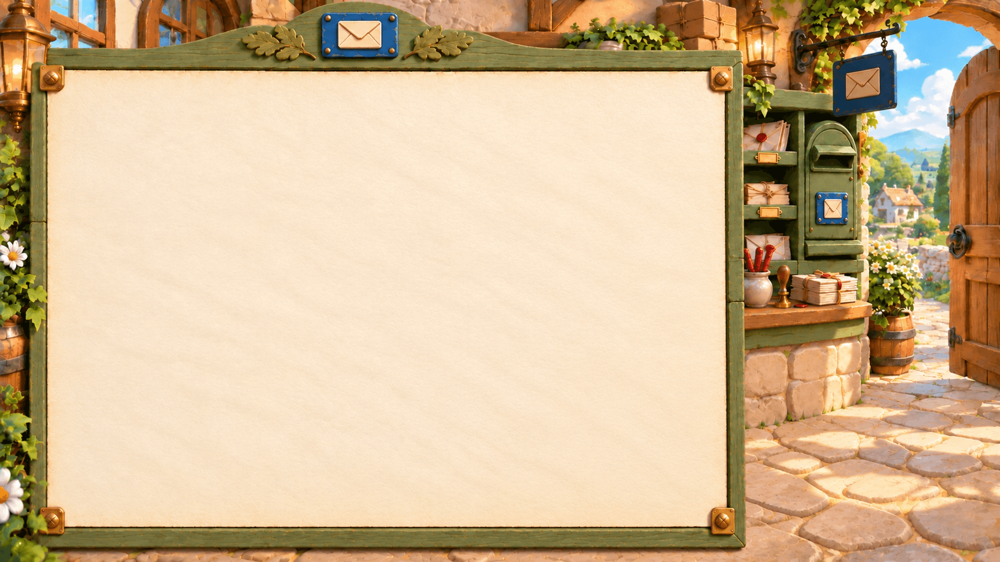
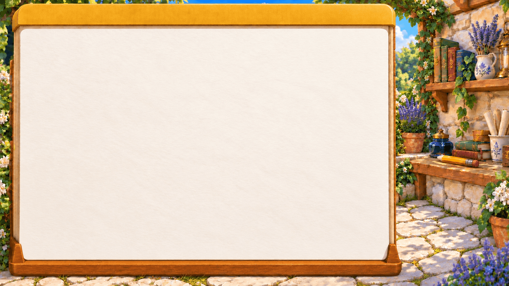
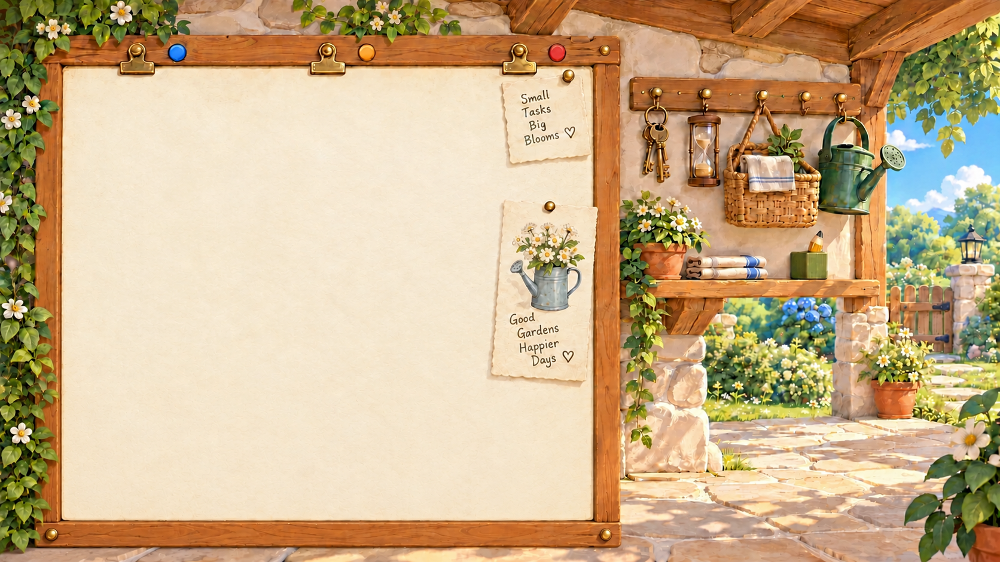
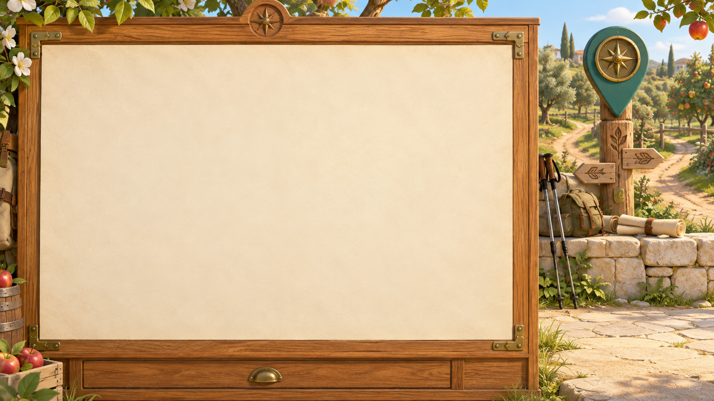
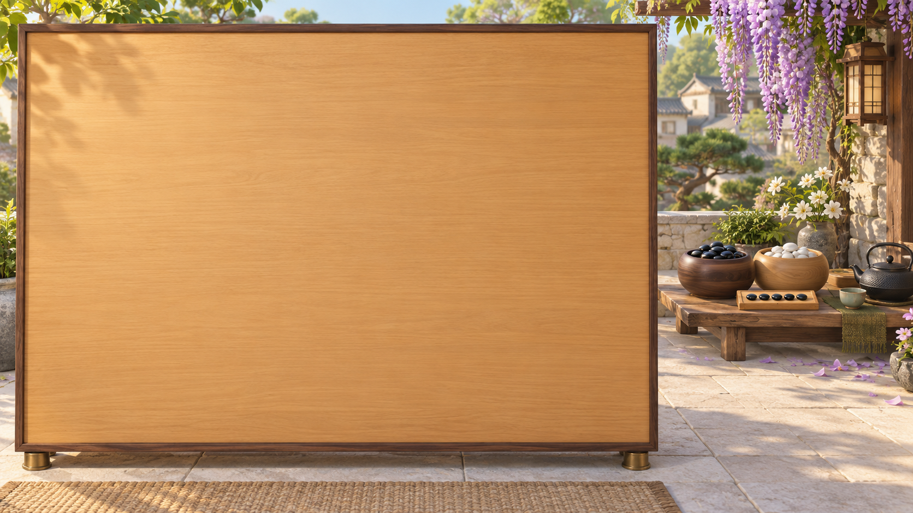

# Village Applet scene library

| Collection | Asset groups | Registered HTML surfaces | Existing art awaiting registration |
| --- | ---: | ---: | ---: |
| Core everyday applications | 18 | 🟢 18 | 0 |
| Individual games: five fixed games + Random | 6 | 🟢 6 | 0 |
| Generic scenes | 16 | 🟢 16 | 0 |
| Brand-specific products and external games | 100 | 0 | 🟡 100 |
| Total art selections | **140** | **40** | **100** |

Green means a matching icon, background and measured HTML region are supplied. It does not mean an application or data connector has been implemented. The 100 branded selections retain their existing art and await registered surfaces. The [SIM inventory](../../../../../ui/theme-packages/village/scene-library.json) contains all 140 selections. Regenerate it with `node scripts/village-scene-library.ts`.

## Core applications and games

The 18 applications are Mail, Calendar, Notes, Reminders, Messages, Voice Memos, Browser, Weather, Maps, Meetings, Files, Clock, Contacts, Photos, Music, News, Podcasts and Stocks. The six game selections are 2048, Snake, Minesweeper, Sudoku, Gomoku and Random Game.

Files covers documents, spreadsheets, presentations and PDFs. Photos and Music have provider-neutral identities suitable for combining services later. News is intended for curated reading. Their pictures and regions are ready; new application behavior, data integration and the Gomoku game implementation remain separate work. Google Maps remains a branded selection alongside the new generic Maps artwork.

Ongoing is an internal type for persistent conversations, not a standalone core art selection; choose a generic scene matching its subject. Artifact, Journal, Settings, the Games hub and an App Store are outside the 140 selections. Fitness remains a generic scene rather than a new core application.

## The 100 branded selections

Keep the branded collection at 100 groups. Exclude three narrow external mini-games with overlapping coverage: Rogue AI Tic-Tac-Toe (`sekai-rogue-ai-tic-tac-toe`), Mixing Colors (`sekai-mixing-colors`) and Roller Coaster Builder (`sekai-roller-coaster`). The main Sekai entry remains. This is an editorial art selection based on scope overlap, not a measured usage ranking; it does not remove runtime Applets or existing user installations.

## iPhone comparison

Apple's current US [iPhone 17 specification](https://www.apple.com/iphone-17/specs/) lists 48 built-in apps, counted on 2026-10-11. This device/region-specific list includes Apple's creative apps and system utilities; it is not a target count for Worldlet.

Statuses describe repository structure, not feature acceptance: **Present** means an existing dedicated Applet/module; **Related** means only a website, partial module or art preset; **Planned** means confirmed but not implemented; **Absent** means no dedicated counterpart; **Excluded** means a hub or host surface outside this comparison. Provider acceptance and platform availability require separate validation.

The 48 source entries are retained for completeness: **8 present, 21 related, 2 planned, 14 absent and 3 excluded**. The comparison scope is 45 entries after exclusions. Meetings is an additional Worldlet tool outside this iPhone list.

### 🟢 Dedicated Applet exists (8)

| # | iPhone app | Status | Current Worldlet counterpart |
| --- | --- | --- | --- |
| 4 | Calendar | Present | Calendar Applet; registered art updated |
| 23 | Mail | Present | Mail Applet; registered art updated |
| 26 | Messages | Present | Messages Applet using native records |
| 29 | Notes | Present | Notes Applet; registered art updated |
| 37 | Reminders | Present | Reminders Applet; registered art updated |
| 38 | Safari | Present | Browser Applet |
| 45 | Voice Memos | Present | Voice Memos Applet using native records |
| 48 | Weather | Present | Weather Applet; remains core |

### 🟡 Related capability only (21)

| # | iPhone app | Status | Current Worldlet counterpart |
| --- | --- | --- | --- |
| 2 | Books | Related | Reading/research art preset; no standalone book library or reader |
| 9 | FaceTime | Related | Zoom and Teams launch-only web entries; no native calling counterpart |
| 12 | Fitness | Related | Strava/Fitbit web entries and fitness art preset; no unified fitness tool |
| 13 | Freeform | Related | Artifacts display structured cards; no freeform collaborative whiteboard |
| 16 | Health | Related | Oura/Fitbit web entries and wellness presets; no unified health-record tool |
| 18 | iMovie | Related | CapCut launch-only web entry; no built-in video editor |
| 20 | Journal | Related | System Journal retains Agent artifact cards; personal-journal art preset exists, not an equivalent personal diary editor |
| 21 | Keynote | Related | Google Slides marked building; PowerPoint launch-only |
| 24 | Maps | Related | Google Maps embedded website; no generic core Maps tool |
| 27 | Music | Related | Apple Music and Spotify launch-only web entries |
| 28 | News | Related | Attention surfaces relevant information; no standalone news reader |
| 30 | Numbers | Related | Google Sheets marked building; Excel launch-only |
| 31 | Pages | Related | Google Docs marked building; Word launch-only |
| 34 | Photos | Related | Google Photos launch-only; no generic local photo library |
| 35 | Podcasts | Related | Apple Podcasts launch-only web entry |
| 36 | Preview | Related | Acrobat launch-only entry; document preview belongs in the planned Files scope |
| 40 | Shortcuts | Related | Agent/Routines handle some automation; no equivalent visual workflow editor |
| 42 | Tips | Related | Onboarding/tour and documentation; no separate tips Applet |
| 43 | Translate | Related | Language-practice art preset; no standalone translation Applet |
| 44 | TV | Related | Netflix and YouTube web entries; no Apple TV counterpart |
| 46 | Wallet | Related | Payment-service entries such as PayPal/Alipay; no unified cards, passes or wallet |

### 🔵 Confirmed additions, not implemented (2)

| # | iPhone app | Status | Current Worldlet counterpart |
| --- | --- | --- | --- |
| 6 | Clock | Planned | Confirmed next core tool; art and runtime pending |
| 10 | Files | Planned | Confirmed next core tool; art and runtime pending |

### 🔴 No dedicated counterpart (14)

| # | iPhone app | Status | Current Worldlet counterpart |
| --- | --- | --- | --- |
| 3 | Calculator | Absent | No standalone calculator Applet |
| 5 | Camera | Absent | No standalone camera Applet |
| 7 | Compass | Absent | No compass Applet |
| 8 | Contacts | Absent | Messages can resolve contact names, but no standalone contacts Applet |
| 11 | Find My | Absent | No device/item-location Applet |
| 15 | GarageBand | Absent | No music creation Applet |
| 17 | Home | Absent | No smart-home control Applet; home-care preset is household planning |
| 19 | iTunes Store | Absent | No media purchase storefront |
| 22 | Magnifier | Absent | No magnifier Applet |
| 25 | Measure | Absent | No measuring Applet |
| 32 | Passwords | Absent | No user-facing password-manager Applet; connection credentials are a separate concern |
| 33 | Phone | Absent | No standalone dialer Applet |
| 41 | Stocks | Absent | No dedicated market/watchlist Applet; financial-service entries are not a substitute |
| 47 | Watch | Absent | No watch-management Applet |

### ⚪ Outside the basic-Applet scope (3)

| # | iPhone app | Status | Current Worldlet counterpart |
| --- | --- | --- | --- |
| 1 | App Store | Excluded | Marketplace; excluded from the basic-Applet scope |
| 14 | Games | Excluded | Game hub; individual playable game Applets are counted separately |
| 39 | Settings | Excluded | Host settings surface; not a standalone Applet |

Prioritize Files and Clock now. Calculator and Contacts are the clearest next candidates if the everyday toolkit expands again. Meetings is Worldlet-specific and should not be treated as the equivalent of FaceTime.

## Local data for the planned tools

Prefer the user’s existing records over a separate demo-only store. The host obtains authorized local data through native adapters, Core supplies shared records and actions, and the Applet renders live HTML in the SIM’s registered surfaces. Theme assets do not read files, hold credentials or request OS permissions. A registered background alone does not connect an account or a local application. See the [connector reference](../../../../../core/applets/INTEGRATIONS.md#local-home-adapters) for implementation and acceptance evidence.

- **Files:** start with explicitly selected local folders and Agent-created documents. File selection, enumeration and preview must use the host’s filesystem boundary; show the real source and open the original file. A cloud file visible locally may still need downloading. Do not imply access to every cloud provider or private application database.
- **Clock:** start with system time, world time, stopwatch and Worldlet-owned timers/alarms. Background delivery and restart behavior need runtime implementation and validation. Synchronizing existing Apple Clock alarms is not established and is not part of the initial promise.
- **Other local apps:** reuse existing Calendar/Reminders, Notes, Messages and Voice Memos adapters where supported; Meetings can use calendar meeting records. Mail currently uses the Google connection, while a local Apple Mail adapter remains proposed. Obsidian demonstrates the chosen-folder approach for a branded app. A web launcher is not a local-data connector.

Apple-specific adapters concern data available on the Mac, including data already synced there. They do not provide arbitrary access to iPhone app storage or establish Windows parity. Each adapter needs its own permission and live-account acceptance checks; code and sample previews alone are not evidence that a user's data is connected. Voice Memos’ optional native-library reader depends on an undocumented local store, so selected audio folders remain an important fallback.

If the toolkit expands later, Contacts and Photos have official local-data APIs worth evaluating: [Contacts](https://developer.apple.com/documentation/contacts/accessing-the-contact-store) and [PhotoKit](https://developer.apple.com/documentation/photokit). These are candidates, not confirmed additions or implemented connectors.

## Design and integration

Match the Village world and each existing icon's recognizable objects, palette and materials. The icon's display base stays in the icon; the background expands those objects into a functional place. Brand-specific scenes must integrate recognizable product identity meaningfully, without sacrificing usable space. Vary the environment by activity: orchard, kitchen, trail, greenhouse, library, guildhall or workshop.

Every updated background has blank painted surfaces for live HTML, a large primary region on the left and quiet lower-right companion clearance. Calendar and eight generic scenes also have a separate auxiliary surface. Paper texture and frames are baked into the image; dates, labels, task state and controls are HTML. Surface coordinates were measured on the final image, with conservative insets around rings, props and perspective edges. The World map and existing Applet icons are unchanged. Ten new icons use the same wooden plinth and brass status-lamp treatment. New backgrounds use one uninterrupted primary rectangle: address-book paper, album paper, a radio display, a ledger leaf or a game tray. Decorative object shapes do not constrain the HTML layout. Keep content blank in the painting, with no baked lists, dates, game grids or controls.

The [Theme contract](../../../../themes/CONTRACT.md#registered-backgrounds-and-live-html) describes `appletScenes` and optional preset `registration`. It includes image dimensions, an encoded-image hash, named primary/secondary regions, material hints and companion clearance. The host keeps responsibility for data, actions, typography, responsive behavior and browser isolation.

This package update supplies art, metadata, validation and shared transform helpers. Production Applet readers and the custom-Applet picker have not adopted the new registered surfaces yet. The preview below demonstrates HTML alignment and local interactions with fictional data; it is not a live account connection.

## Interactive preview

```sh
node scripts/applet-scene-preview.ts
python3 -m http.server 8787 --bind 127.0.0.1
```

Open `/output/applet-scene-preview/` on that local server. Browse the 24 core pairs and 16 generic pairs below the stage, or select a scene. The stage starts with artwork only. Show registration guides to inspect the actual usable rectangle and companion clearance. Existing sample scenes can also show fictional HTML; new scenes intentionally have no placeholder application behavior. Calendar changes weeks, Mail selects letters and opens a reply draft, Notes saves a local session draft, and lists support adding and completing items. All image and HTML regions use the same uniform transform. Narrow views remain a design preview; production should use a readable responsive page when the scene no longer provides sufficient space.

## Core scenes

### Calendar


Primary HTML region: 52.5% of image width × 51.0% of image height; measured inside the painted surface.


### Mail


Primary HTML region: 50.8% of image width × 50.7% of image height; measured inside the painted surface.



### Notes


Primary HTML region: 53.0% of image width × 59.5% of image height; measured inside the painted surface.



### Reminders


Primary HTML region: 49.3% of image width × 49.0% of image height; measured inside the painted surface.



### Files


Primary HTML region: 65.0% of image width × 69.0% of image height; measured inside the painted surface.


### Weather


Primary HTML region: 54.0% of image width × 67.0% of image height; measured inside the painted surface.


### Meetings


Primary HTML region: 54.0% of image width × 65.0% of image height; measured inside the painted surface.


### Voice Memos


Primary HTML region: 53.0% of image width × 61.0% of image height; measured inside the painted surface.


### Messages


Primary HTML region: 62.0% of image width × 63.0% of image height; measured inside the painted surface.


### Browser


Primary HTML region: 63.5% of image width × 62.0% of image height; measured inside the painted surface.


### Maps


Primary HTML region: 64.0% of image width × 69.0% of image height; measured inside the painted surface.



### Clock


Primary HTML region: 67.0% of image width × 70.0% of image height; measured inside the painted surface.


### Contacts


Primary HTML region: 59.5% of image width × 69.0% of image height; measured inside the painted surface.


### Photos


Primary HTML region: 69.0% of image width × 70.0% of image height; measured inside the painted surface.


### Music


Primary HTML region: 64.0% of image width × 61.0% of image height; measured inside the painted surface.


### News


Primary HTML region: 60.0% of image width × 65.0% of image height; measured inside the painted surface.


### Podcasts


Primary HTML region: 53.0% of image width × 61.0% of image height; measured inside the painted surface.


### Stocks


Primary HTML region: 62.0% of image width × 70.0% of image height; measured inside the painted surface.


### 2048


Primary HTML region: 67.0% of image width × 77.0% of image height; measured inside the painted surface.


### Snake


Primary HTML region: 67.0% of image width × 65.0% of image height; measured inside the painted surface.


### Minesweeper


Primary HTML region: 59.0% of image width × 67.0% of image height; measured inside the painted surface.


### Sudoku


Primary HTML region: 66.0% of image width × 70.0% of image height; measured inside the painted surface.


### Gomoku


Primary HTML region: 66.0% of image width × 76.0% of image height; measured inside the painted surface.



### Random Game


Primary HTML region: 51.5% of image width × 62.0% of image height; measured inside the painted surface.


## Generic scenes

### Weight balance

Track weight trends, measurements and personal goals.


### Meal planner

Plan weekly meals and reuse pantry ingredients.


### Workout plan

Plan workouts and record progress.


### Sleep & recovery

Review sleep records and plan wind-down routines.


### Travel planner

Compare destinations and organize itineraries.


### Outdoor adventures

Prepare walks, hikes, weather checks and packing lists.


### Shopping list

Collect grocery needs and compare purchases.


### Household budget

Categorize expenses, monitor budgets and bill dates.


### Home care

Schedule chores, maintenance and household tasks.


### Garden planner

Plan planting, watering and seasonal garden work.


### Daily planner

Collect today's schedule, priorities and reminders.


### Reading & research

Save reading, summarize sources and gather research.


### Language practice

Practice conversation, vocabulary and study routines.


### Personal journal

Capture reflections, memories and daily notes.


### Job search

Compare openings, track applications and prepare interviews.


### Project planner

Track milestones, tasks and next actions.


## Sources and reproducibility

The built-in image-generation tool created these backgrounds. [Core prompts and measured regions](catalog.json) retain the original request, icon references and refinements. [Generic prompts and registrations](../../presets/personal-scenes/catalog.json) retain original and updated background prompts. Source PNG hashes are in the generic source lock; runtime WebP source/output hashes are in each package art lock. New transparent icon sources and their prompts are also recorded in the core catalog; `icons.lock.json` records their lossless 768-pixel WebP exports.

```sh
node scripts/village-registered-scenes.ts
node scripts/village-applet-presets.ts
node scripts/village-scene-library.ts
npm run check:style
```

Encoding preserves source aspect ratios. Replacing a background requires re-measuring its regions before encoding; import rejects registrations tied to different encoded bytes or dimensions.
