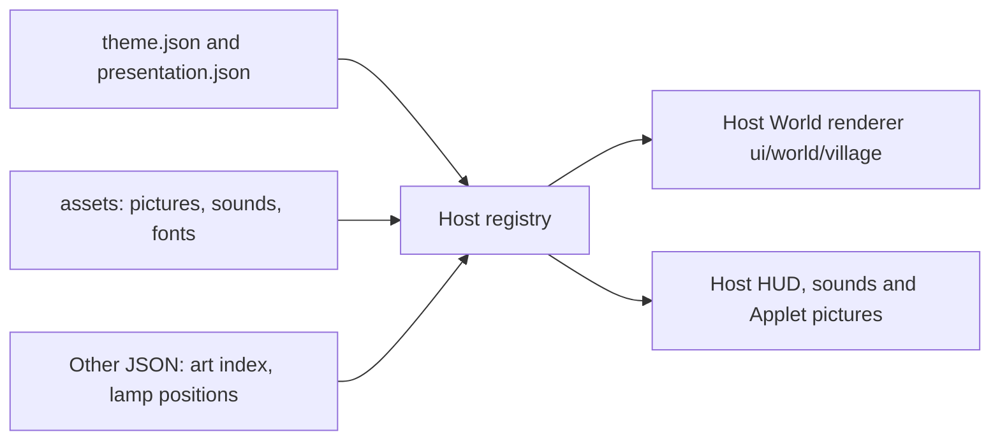

# Theme contract (v3)

A theme is **static**: pictures, sounds, fonts and JSON. It holds no code and no stylesheet, and nothing in it runs. The main repository draws the World and every Applet page itself and reads from the theme only what this contract declares (owner decision 2026-10-10: "Theme 都是静态资源，不要让它去靠什么 render 什么东西了").

Worldlet bundles one theme, the Village, in `ui/theme-packages/village/`; there is no theme picker. The main repository owns the executable [TypeScript contract](../../ui/themes/build-theme-contract.ts), the [import validator](../../scripts/build-theme-source.ts) and the [registry](../../ui/themes/build-theme.ts). Packages are bundled into the app; nothing is downloaded at runtime.



## Package and validation

```text
package/
  theme.json          # contractVersion: 3, id, title, assets, presentation, optional updatedAt
  presentation.json   # tokens, fonts, optional hud, sound, icons, artifact, appletPresets, appletScenes and sceneMaterials
  assets/             # every picture, sound, font and licence the JSON names
  *.json              # other data the host's World code reads (the Village's lamps.json, assets/art.json)
```

`theme.json` fixes `assets: "assets"` and `presentation: "presentation.json"`; any other field is refused. `presentation.json` holds only `tokens`, `fonts`, `hud`, `sound`, `icons`, `artifact`, `appletPresets`, `appletScenes` and `sceneMaterials`. Image registration records painted surface bounds; executable layouts, viewport CSS and placement of host controls remain the host’s responsibility.

Themes do not have release version numbers. Optional `updatedAt` records the last source modification as a UTC timestamp (for example, `2026-10-10T07:10:00Z`); it is informational. `contractVersion` alone controls compatibility; source hashes identify the copied contents.

The importer accepts only static files (`json`, `png`, `webp`, `jpg`, `svg`, fonts, `mp3`, `m4a`, `wav`, `ogg`, `webm`, `txt`, `md`) and rejects code, stylesheets, symlinks, unresolved LFS pointers and any `assets/...` path a JSON file names that the package does not ship. Validated bytes replace `ui/theme-packages/<id>` atomically. The import writes the package's `index.ts`, which imports its JSON for the host (the manifest, the presentation and every other JSON file by package path, which the host reads through `themeData`), records hashes in `source-lock.json` and regenerates `ui/theme-packages/index.ts`. A failed import keeps the previous copy, and builds remove stale output assets.

## What the theme declares

| Field | What the host does with it |
| --- | --- |
| `tokens` | The theme's type and colours: `bodyFont`, `displayFont`, `bodySize` (at least 12), `titleSize`, `ink`, `paper`, `accent`, `focus`, `radius`, `controlHeight` (at least 32). |
| `fonts` | Bundled font files, each with its `license` file. Shared fonts use an empty list. |
| `hud.skin` (optional) | Nine-slice pictures for the shared HUD pieces `attention`, `note`, `back`, `log`, `button`, `card` and `frame`: `image` (`png`, `webp` or `svg`), `slice` insets in image pixels and drawn `width` in CSS pixels (at most 64). |
| `sound.events` (optional) | An audio file per business event: `applet.arrived`, `mail.received`, `task.working`, `task.succeeded`, `task.failed`, `task.cancelled`. |
| `icons` (optional) | The theme's picture of an Applet by Applet key (`png`, `webp` or `svg`). The host shows it everywhere it pictures that Applet: the World, lists, history, the world log and the first-use gathering. |
| `appletPresets` (optional) | Reusable icon/background pairs for custom Applets, with a unique `id`, `title`, `description`, `category`, `icon` and `background`. Both images are package-local `png`, `webp` or `svg` files. |
| `appletScenes` (optional) | Backgrounds keyed by Applet key, with measured image registration for live HTML surfaces. |
| `sceneMaterials` (optional) | How Applet content looks on each region material (`paper`, `board`, `screen`): colours `ink`, `muted`, `line`, `accent`, `accentInk`, `control`, `controlInk` and `fill` (`#rrggbb` or `#rrggbbaa`), and font stacks `bodyFont` and `displayFont`. A role left out comes from `tokens`. |
| `artifact` (optional) | How the theme's Artifacts look, as static files ([Artifacts](#artifacts)). |

Anything left out keeps the shared look, sounds and pictures.

### Custom Applet art presets

The host reads `themeAppletPresets()` from `ui/themes/index.ts`. It returns the active theme's entries with `icon` and `background` resolved to published URLs; a theme without presets returns an empty list. IDs are stable within the theme. Presets are art choices, not Applet keys: they neither register providers nor create Applets, authorize actions or connect user data. The host owns selection, responsive layout and live HTML content.

The Village bundles 16 pairs under `assets/applet-presets/`, declared in `presentation.json`. The [source catalog](../styles/builtin/presets/personal-scenes/README.md) contains the full visual gallery and research. An Applet creation picker is not connected yet. For example, host code can read `themeAppletPresets().find(p => p.id === 'meal-planner')` and use its image URLs.

### Registered backgrounds and live HTML

`themeAppletScene(appletKey)` returns an optional Applet-bound background with its published URL and `registration`. Reusable `appletPresets` can also carry `registration`. An Applet's icon still comes from `icons` using the same key; a generic preset carries its own icon. No registration means the existing host presentation continues.

| Registration field | Meaning |
| --- | --- |
| `imageSize` | Final encoded image width and height in pixels. |
| `sha256` | SHA-256 of those exact encoded background bytes. Import rejects a stale hash or size. |
| `regions` | Nonoverlapping painted blank surfaces. Each has a unique `id`, `role` (`primary` or `secondary`), normalized `rect: [x,y,width,height]`, and `material` (`paper`, `board`, `screen`). Exactly one primary is required. |
| `webEdge` (optional) | Clockwise `top`, `right`, `bottom`, `left` sample arrays (2–64 values per side, 0–3 source pixels). Original background pixels overlap the outer edge of a live website; the host scales them down with the scene and caps enlargement. No input capture or website styling. |
| `companion` | A separate normalized rectangle describing quiet painted clearance. This does not position or style Fox. |

Coordinates start at the image's upper-left and stay within 0–1. They are measured from the finished picture, not guessed from a generation prompt. `fitThemeScene(registration, width, height)` applies one centered, uniform contain transform to the painting, every region and companion clearance. Do not crop the background independently. The host chooses its responsive presentation and may switch to a normal readable page on narrow viewports instead of shrinking interactive text.

Keep dates, messages, task state and controls out of the bitmap. The host supplies real HTML and trusted data inside those surfaces. A Calendar can have a main event surface and a separate small date surface. Regions grant no capabilities, execute no code and bind no provider data themselves. Embedded external websites still require the host's browser surface and cannot acquire this appearance from artwork alone.

The host draws registered scenes with one shared renderer, [ui/applets/scene](../../ui/applets/scene/README.md): it lays the painting out with `fitThemeScene`, puts a live HTML element on every region and gives each region its `sceneMaterials` entry as CSS variables. An Applet fills the regions with its records and the shared controls and names no coordinate, colour or font, so a theme changes how an Applet looks without a change to the Applet. Mail is drawn this way; the other Applets keep their current pages until they move over, and the preset picker has not adopted registered surfaces yet.

The [Village scene library](../styles/builtin/references/registered-scenes/README.md) includes the inventory and an interactive preview with fictional data.

### Artifacts

An Artifact is a card Fox puts in front of the person ([core/artifacts](../../core/artifacts/README.md)). The theme says how it looks; the host makes it. The section holds no template, stylesheet or script, only files a person or a model reads:

| Field | What it is |
| --- | --- |
| `style` | Design rules for an Artifact in this theme (`.md` under `assets/`): material, layout, type, colour, illustration, interaction and acceptance |
| `prompt` | The prompt the host's generator receives with the content, the room it has and the capabilities the host gives (`.md`) |
| `references` | 1 to 6 pictures of finished Artifacts, each with its `role`; the first is the visual standard |
| `materials` (optional) | Up to 12 pictures a generated Artifact may place, each with an `id` and its `usage` |
| `colors` (optional) | `#rrggbb` per colour role: `paper`, `ink`, `brass` and one accent per tone (`moss`, `teal`, `honey`, `sage`, `clay`, `plum`) |

The host reads it with `themeArtifact()` (`ui/themes/build-theme.ts`). The same look serves both ways the host makes an Artifact: filling its own card with the words Fox wrote, and having the Agent write a whole page, which the host shows isolated. A theme without the section keeps the host's card. Brand logos (the HUD title bar, picture-in-picture) stay the host's.

Assets at `assets/...` are published to `theme-assets/<id>/...`; the host resolves them with `themeAssetURL`.

Not part of a theme: how the World and Applet pages are drawn (the host's code), the companion (Fox, its rig and portrait, where it stands, its reply bubble, panel and nameplate), and the loading and first-use pages.

## The Village

The Village package is the one description of the Village: its art in `assets/` (`art.json` indexes it; `scripts/village-art.ts` encodes it from the painted sources), `lamps.json` (where each device's lamp sits), Applet `icons` for every catalog Applet, and the host's pack of it: `pack.json` (space, layout, motion, companion and surfaces; `ui/themes/theme-pack.ts`), `style.json` and `tokens.json` (its Style Pack; `ui/components/style.ts`) and `world.json` (areas, slots and plates; `ui/world/world-pack.ts`). The painted sources these name stay in `resources/styles/builtin` and `resources/worlds/village`. The animated Pixi World that draws it is the host's code in `ui/world/village/` (`village-world.ts` behind the host's World mount, `ui/world/world-renderer.ts`). Its Applets open in the host's own Applet pages, and the host draws the pins, lamp labels, lamps on device pictures and the zoom between World and Applet. Its Artifact look is in `assets/artifact/` ([the style pack](../../ui/theme-packages/village/assets/artifact/README.md)), declared in `presentation.json`. One folder in the package is reference material the host does not read and the app does not ship (only `assets/` is published): `areas/` (painted day and night close views of the six places, not used yet).

## Checking a package

```sh
npm run theme:source-check -- /path/to/your-theme
npm run theme:import -- /path/to/your-theme
npm run test:theme-source
```

`theme:import` replaces the bundled package with a checked copy.

## Compatibility

Contract v3 is frozen. `ui/themes/frozen/contract-v3.d.ts` holds its declarations and `scripts/fixtures/theme-contract-v3/` is a package that uses every part of it. `node scripts/theme-contract-check.ts` runs in PR CI (`npm run check:contracts`) and fails when a change would break a package written against v3: the frozen manifest and presentation must still be accepted, no frozen field may be removed, and the frozen package must still validate.

An additive, optional change passes; refresh the snapshot in the same PR with `node scripts/theme-contract-check.ts --freeze`. Anything else needs contract v4 with its own snapshot and frozen package. Incompatible versions fail at import before copying.

Contract v2 let a package ship code (`renderWorld`, `renderApplet`) and a stylesheet. It was retired on 2026-10-10 when themes became static; no package uses it.

The old data-only `ThemePack` (`ui/themes/theme-pack.ts`) only describes the Village's source art and companion; it is not a theme API.
